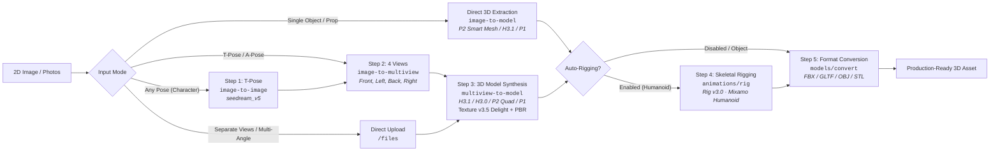

# Tripo 3D Tool

[](https://nodejs.org/)
[](https://developers.tripo3d.ai/)
[]()
[-success.svg)]()
[](SECURITY.md)

A production-grade, security-hardened web application and API proxy for generating textured, rigged, production-ready 3D characters, objects, and props (e.g. glasses, accessories, hard-surface assets) from 2D images using the official **Tripo AI V3 REST API**.

Created as an independent project by [Lens4web](https://lens4web.com/).  
Live deployment: **[tripo3d.lens4web.com](https://tripo3d.lens4web.com)**

---

## Architecture & Generation Pipeline



---

## Key Features & Tripo V3 Model Support

### 1. Dual Pipeline: Objects / Props & Humanoid Characters
- **Single Object / Prop Mode**: Directly synthesizes 3D models via `/v3/generation/image-to-model` from a single reference photo (e.g., glasses, eyewear, footwear, industrial products, props, tabletop items) without hallucinating human poses or running irrelevant skeletal checks.
- **Multi-Angle Object Photos**: Leverages `/v3/generation/multiview-to-model` with multi-angle reference photos (Front, Left/Side, Back, Right/Side) for high-accuracy hard-surface reconstructions.
- **Humanoid Character Workflow**: Automated pipeline normalizing arbitrary poses into T-poses via Seedream v5, hallucinating four orthogonal views, and binding Mixamo-standard biped skeletons.

### 2. Advanced 3D Foundation & Premium Models
- **Built-in Model Comparison Guide**: Interactive modal dialog and dynamic contextual hints explaining topology, face limits, texturing versions, and best use cases for every Tripo AI neural model.
- **Standard Foundation Models**:
  - `v3.1-20260211` (H3.1 Standard, up to 1.5M faces) — high-density triangles for organic and intricate sculpts.
  - `v3.0-20250812` (H3.0 Standard, up to 1M faces) — reliable general-purpose generation.
  - `v2.5-20250123` (H2.5 Standard, up to 500k faces) — legacy backward-compatible model.
- **Premium Mesh Engines**:
  - `P2-20260801` (P2 Premium) — features **Smart Mesh Quad Topology** (48–25,000 quad polygons; 48–50,000 triangle polygons), ideal for hard-surface objects like glasses, product design, clean edge-flow animation, and game assets.
  - `P1-20260311` (P1 Premium) — crisp geometry and sharp silhouettes (50–20,000 faces; quad restricted).
- **Texture v3.5 & Delighting**:
  - Automatically incorporates `texture_version: "v3.5-20260815"`, high-fidelity PBR maps, and automated image delighting (`delight: true`) for realistic lighting responses.

### 3. Skeletal Auto-Rigging (Rig v3.0)
- **Automated Humanoid Bones**: Full skeleton binding using `v3.0-20260909` with Mixamo bone naming conventions.
- **Pre-flight Riggability Check**: Automatic non-destructive validation via `/animations/rig-check` confirming biped skeleton topology before processing characters.
- **Export Formats**: Rigged characters export seamlessly as FBX and GLTF/GLB for direct import into Blender, Unity, Unreal Engine, and Mixamo.

### 4. Flexible Multi-View Inputs
- **Any Pose**: Upload any reference picture; the pipeline automatically normalizes it into a standard T-pose before 3D extraction.
- **T-pose / A-pose**: Generates consistent Front, Left, Back, and Right orthographic angle previews.
- **Separate Views**: Upload up to four custom angles (Front + Left, Back, Right) for precise likeness control.

### 5. Zero-Trust Security Architecture
Designed from the ground up to protect host infrastructure in public deployments:
- **Zero Browser Key Persistence**: API keys are submitted only to an isolated session endpoint and **never stored in `localStorage`, `sessionStorage`, or cookies**. Legacy entries are proactively purged.
- **In-Memory Ephemeral Sessions**: Session tokens use cryptographically secure 256-bit random values. Production cookies use `__Host-`, `HttpOnly`, `SameSite=Strict`, and `Secure` flags.
- **User-Controlled Key Revocation**: Keys remain in server memory without arbitrary timeouts and are revoked immediately when the user clicks Disconnect or applies a replacement key, or on process restart.
- **SSRF Defense**: The `/api/download` proxy strictly restricts hostnames to verified Tripo CDN domains (`cdn.tripo3d.ai` and `tripo-data.rg1.data.tripo3d.com`), validates every redirect hop, blocks non-standard ports, and serves payloads with `Content-Disposition: attachment` and `X-Content-Type-Options: nosniff`.
- **Strict Reverse-Proxy Whitelisting**: Upstream requests are tightly filtered to authorized Tripo V3 endpoints. Any cross-origin or unauthorized requests are rejected immediately.
- **Rate Limiting & DoS Mitigation**: In-memory IP rate limiters guard API endpoints against abuse.

### 6. Internationalization & Accessibility
- **6 Supported Languages**: English, Russian, Spanish, German, French, and Simplified Chinese.
- **Language Detection & Crawler SEO**: Automatic browser detection with manual override, prerendered translated HTML, canonical URLs, `hreflang` headers, and valid JSON-LD structured data.
- **System Theme Sync**: Automatically adapts to system light/dark mode preference with seamless manual toggle.

---

## Repository Structure

```
├── app.js                   # Client-side UI controller and pipeline coordinator
├── app.test.js              # Integration test suite for UI, sessions, and pipeline
├── pipeline.js              # Core pipeline calculations, payload schemas, and validation
├── pipeline.test.js         # Unit tests for Tripo V3 endpoints and constraint validation
├── server.js                # Secure Node.js HTTP server, session manager, and API proxy
├── server.test.js           # Server security tests (SSRF, CSRF, rate limits, CSP)
├── i18n.js                  # Internationalization dictionary (6 languages)
├── index.html               # Main application workspace layout
├── styles.css               # Responsive design and dark/light themes
├── deploy/                  # Production deployment templates
│   ├── nginx.conf           # Hardened Nginx configuration template
│   ├── tripo3d.service      # Systemd service unit template
│   └── ubuntu24/            # Ubuntu 24.04-specific configurations
├── SECURITY.md              # Detailed security audit and review report
├── DEPLOY_RU.md             # Deployment guide (Russian)
└── DEPLOY_SERVER_RU.md      # Server setup guide for Ubuntu 24.04 (Russian)
```

---

## Quick Start (Local Development)

### Prerequisites
- [Node.js](https://nodejs.org/) version 22+ or 24 LTS
- A [Tripo AI](https://platform.tripo3d.ai/) account and API key

### 1. Installation

```bash
git clone https://github.com/lens4web/tripo_3d_tool.git
cd tripo_3d_tool
npm ci
```

### 2. Run the Development Server

```bash
npm start
```

Open [http://127.0.0.1:3000](http://127.0.0.1:3000) in your browser.

### 3. Usage
1. Enter your Tripo API key in the connection box and click **Apply key**.
2. Select your input mode and generation options (model version, target format, auto-rigging, quad mesh).
3. Upload your character image(s) and click **Generate character**.
4. Track real-time stage progress and download the resulting 2D views and 3D files.

---

## Automated Testing & Security Verification

All tests run locally using deterministic mock endpoints and require zero Tripo credits:

```bash
# Run complete test suite (26 tests covering unit, pipeline, and server security)
npm test

# Verify production dependency vulnerabilities
npm audit --omit=dev
```

---

## Production Deployment

This application is designed to run as an unprivileged background service behind a hardened reverse proxy (e.g., Nginx) enforcing HTTPS.

### 1. Environment Configuration

Copy the example configuration to `/etc/tripo3d.env`:

```bash
sudo cp .env.example /etc/tripo3d.env
sudo chmod 600 /etc/tripo3d.env
```

Ensure `PUBLIC_ORIGIN` matches your public domain:

```env
NODE_ENV=production
HOST=127.0.0.1
PORT=3000
PUBLIC_ORIGIN=https://tripo3d.lens4web.com
```

> **Note:** Do not store Tripo API keys in `.env`. Users supply their own keys per session in their browser.

### 2. Systemd Service Setup

Install and enable the systemd service:

```bash
sudo cp deploy/tripo3d.service /etc/systemd/system/
sudo systemctl daemon-reload
sudo systemctl enable --now tripo3d
sudo systemctl status tripo3d
```

The service runs under an isolated `tripo3d` system user with `ProtectSystem=strict`, `ProtectHome=true`, and disabled core dumps.

### 3. Nginx Reverse Proxy Setup

Configure Nginx to proxy HTTPS traffic to `127.0.0.1:3000`. Reference configuration templates are available in `deploy/nginx.conf` and `deploy/ubuntu24/`.

Key proxy requirements:
- Preserve client cookies (`Cookie`, `Set-Cookie`).
- Forward client IP headers (`X-Forwarded-For`, `X-Forwarded-Proto`).
- Disable access logging for `/api/download` to prevent recording signed temporary URLs.
- Enforce modern TLS (TLS 1.2 / TLS 1.3) and HTTP Strict Transport Security (HSTS).

For detailed server deployment instructions in Russian, see [DEPLOY_RU.md](DEPLOY_RU.md) and [DEPLOY_SERVER_RU.md](DEPLOY_SERVER_RU.md).

---

## Security Policy

Security considerations, defense-in-depth measures, session lifetimes, and threat mitigations are documented in [SECURITY.md](SECURITY.md).

To report a vulnerability or issue, please reach out via [Lens4web Feedback](https://lens4web.com/).

---

## License & Attribution

- Developed by [Lens4web](https://lens4web.com/) for personal and community use.
- Uses the official [Tripo AI REST API](https://developers.tripo3d.ai/). Tripo is a trademark of its respective owner.
- Released under open-source terms. See repository commits and source headers for details.

